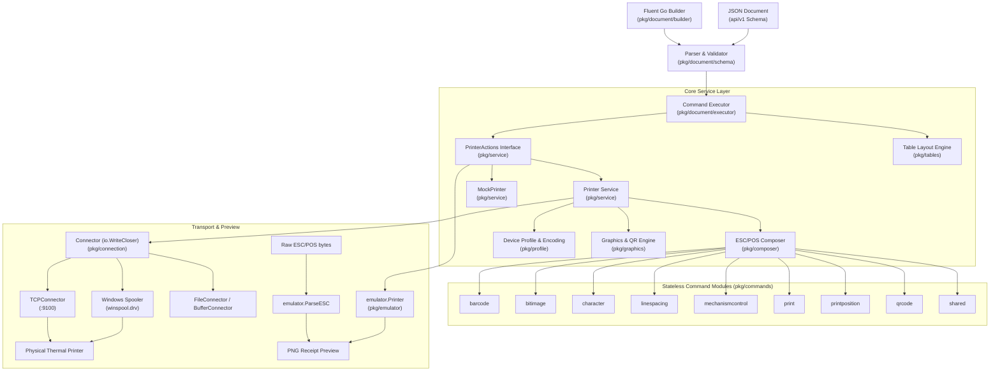

# Poster: Thermal Printer Driver & ESC/POS Utility


[](https://github.com/adcondev/poster/actions/workflows/ci.yml)

[](https://github.com/adcondev/poster/security/code-scanning)
[](https://github.com/adcondev/poster/actions/workflows/release.yml)

[](https://codecov.io/github/adcondev/poster)
[](https://goreportcard.com/report/github.com/adcondev/poster)
[](https://pkg.go.dev/github.com/adcondev/poster)

[](https://github.com/adcondev/poster/network/updates)
[](https://conventionalcommits.org)

<p align="center">
  
</p>

A professional, production-ready Go library and command-line utility for controlling ESC/POS thermal printers. Designed for high-reliability retail and POS environments, it features a robust JSON-based document protocol, native Windows Spooler integration, an advanced graphics engine, and a **visual emulator** for testing without physical hardware.

## 🚀 Key Features

- **JSON Document Protocol**: Define print jobs using a clean, versioned JSON schema (`v1.0`). Decouples business logic from hardware commands with full schema validation.
- **Pluggable Transports (`io.WriteCloser`)**: Native Windows Print Spooler (`winspool.drv`), pure-Go cross-platform raw TCP (`:9100`), file/device output (`.bin` files, `/dev/usb/lp*`), and in-memory buffers.
- **Advanced Graphics Engine**:
    - Monochrome rasterization with **Atkinson**, **Floyd-Steinberg**, **Ordered (4x4 Bayer)**, and **Threshold** dithering.
    - Configurable image scaling (`bilinear` and `nns` / `nearest_neighbor`), profile-aware max width, and automatic horizontal **band chunking** (`MaxBandHeight`) for small-buffer printers.
    - Supports PNG, JPEG, and BMP formats (file paths or Base64).
- **Smart QR, PDF417 & Native Barcodes**:
    - **QR Codes**: Automatically selects between native printer firmware commands (`GS ( k`) and software bitmap rendering (`pkg/graphics`) when custom **logo overlays**, **circular modules** (`circle_shape`), or non-QR profiles are used.
    - **PDF417**: Native `GS ( k` (`cn=48`) with columns, rows, module width, row height, and error-correction level.
    - **1D Barcodes**: Native ESC/POS (`GS k`) supporting `CODE128` (auto Set B/C), `CODE128_AUTO`, `GS1-128`, `CODE93`, `EAN13`, `EAN8`, `UPCA`, `UPCE`, `CODE39`, `ITF`, and `CODABAR`.
- **Dynamic Table Layout**: Pure-text engine (`pkg/tables`, no ESC/POS coupling) with UTF-8 word wrapping, multi-column support, Font B, configurable column spacing, overflow detection, and widest-column-first `ReduceToFit`.
- **Visual Emulator & Reverse Parser**:
    - `emulator.Printer` implements `service.PrinterActions`, so any `schema.Document` can be rendered to PNG via the same `executor` (`poster -preview out.png`).
    - `emulator.RenderBytesToPNG` parses **raw ESC/POS byte streams** (text, styles, alignment, cuts, `GS v 0` rasters) back into a PNG preview.
- **International Encoding ("Magic Encode")**: 25 code tables, smart-typography normalization (curly quotes, dashes, ellipsis, NBSP), optional mid-string `ESC t n` auto-switching across fallback code pages, and `'?'` replacement (or `StrictEncoding`) for unmappable runes.
- **Hardware Profiles**: Generic 80mm (`576` dots) / 58mm (`384` dots), PT-210, GP-58N, EC-PM-80250, Epson TM-T20III / TM-T88VI, Star TSP100, Bixolon SRP-350III, and Xprinter XP-58 / XP-80 presets resolvable by model name (`profile.ProfileFromModel`).
- **Smart Printer Discovery**: Enumerates and filters physical vs. virtual thermal/POS printers installed in the Windows Print Spooler.
- **12 Document Command Types**: `text`, `image`, `barcode`, `qr`, `pdf417`, `table`, `separator`, `feed`, `cut`, `raw`, `pulse`, `beep`.
- **Raw Command Support**: Send raw hex/base64 ESC/POS byte sequences with optional safety checks against bidirectional lockups.

## 🏗️ Architecture

Poster follows a strict layered architecture separating JSON schema contracts, high-level orchestration, pure ESC/POS command generation, and OS transport:



### Package Structure

| Package | Description |
|---|---|
| `api/v1` | Canonical JSON Schema (`ticket_document.schema.json`) and protocol specification (`TICKET_DOCUMENT_V1.md`) |
| `cmd/poster` | CLI for printer discovery, JSON validation (`--dry-run`), PNG preview (`-preview`), and printing via Windows Spooler, TCP, or file |
| `internal/calculate` | Millimeter, DPI, and dot-per-line math utilities |
| `internal/load` | Path-traversal-safe file loader and PNG/JPEG/BMP image decoding (file & Base64) |
| `internal/testutils` | Shared unit test assertions, byte slice validators, and mock helpers |
| `pkg/commands` | Pure, stateless ESC/POS command builders (`barcode`, `bitimage`, `character`, `linespacing`, `mechanismcontrol`, `print`, `printposition`, `qrcode` incl. PDF417, `shared`) |
| `pkg/composer` | High-level ESC/POS protocol facade (`EscposProtocol`) |
| `pkg/connection` | `Connector` interface plus `WindowsPrintConnector`, `TCPConnector`, `FileConnector`, `BufferConnector`, and printer discovery/filtering |
| `pkg/constants` | Shared typed enums, standard paper/dot geometry (`576` / `384` dots), and schema-aligned defaults |
| `pkg/document` | JSON document AST & validator (`schema`), fluent Go DSL (`builder`), and command runner (`executor`) |
| `pkg/emulator` | 2D receipt renderer, `PrinterActions` adapter (`emulator.Printer`), and raw ESC/POS byte parser (`ParseESC`, `RenderBytesToPNG`) |
| `pkg/graphics` | Image loading/scaling, Atkinson/Floyd-Steinberg/Ordered/Threshold dithering, 1-bit bitmaps with band slicing, QR rendering, barcode mapping |
| `pkg/profile` | Hardware profiles & model presets, 25 code tables, typography normalization, and multi-codepage `EncodeBytesSafe` |
| `pkg/service` | Stateful printer service (`Printer`, functional options), `PrinterActions` interface, and `MockPrinter` |
| `pkg/tables` | Pure-text multi-column table engine with UTF-8 word wrapping, `RenderStructured`, and `ReduceToFit` auto-balancing |

## 📦 Installation

### Prerequisites

- **Go** `1.24.6` or higher
- **Windows OS** for native `winspool.drv` hardware printing (all library packages, tests, and the visual emulator run cross-platform on Linux, macOS, and Windows)

### As a Go Module

```bash
go get github.com/adcondev/poster@latest
```

### Build from Source

```bash
# Clone the repository
git clone https://github.com/adcondev/poster.git
cd poster

# Build the CLI binary
go build -o ./bin/poster ./cmd/poster

# Or run tests, linter, and build via Taskfile
task build
```

## 📖 Usage

### Command Line Interface (CLI)

The `poster` CLI validates, previews, and prints JSON ticket documents:

```bash
# Print via the Windows Print Spooler (default transport, Windows only)
poster -file receipt.json -printer "EPSON TM-T88V"

# Print to a network printer over raw TCP (any OS)
poster -file receipt.json -t tcp -network 192.168.1.100:9100

# Write raw ESC/POS bytes to a file or device (any OS)
poster -file receipt.json -t file -o receipt.bin
poster -file receipt.json -t file -o /dev/usb/lp0

# Render a PNG preview without hardware (any OS)
poster -file receipt.json -preview receipt.png

# Dry-run (validate JSON schema and commands without touching hardware)
poster -file receipt.json --dry-run

# List installed printers (Windows only)
poster --list
poster --list-thermal
poster --list-physical
poster --list --json

# Show version
poster -v
```

### JSON Document Example (`api/v1`)

Create a file named `ticket.json` conforming to [`api/v1/ticket_document.schema.json`](api/v1/ticket_document.schema.json):

```json
{
  "version": "1.0",
  "profile": {
    "model": "Generic 80mm",
    "paper_width": 80,
    "dpi": 203,
    "has_qr": true
  },
  "commands": [
    {
      "type": "text",
      "data": {
        "content": {
          "text": "STORE NAME",
          "align": "center",
          "content_style": {
            "bold": true,
            "size": "2x2"
          }
        }
      }
    },
    {
      "type": "separator",
      "data": {
        "char": "-",
        "length": 48
      }
    },
    {
      "type": "table",
      "data": {
        "definition": {
          "columns": [
            { "name": "Item", "width": 20, "align": "left" },
            { "name": "Price", "width": 10, "align": "right" }
          ]
        },
        "show_headers": true,
        "rows": [
          ["Coffee", "$3.50"],
          ["Sandwich", "$8.00"]
        ],
        "options": {
          "header_bold": true,
          "word_wrap": true,
          "column_spacing": 1,
          "auto_reduce": true
        }
      }
    },
    {
      "type": "qr",
      "data": {
        "data": "https://example.com",
        "align": "center",
        "pixel_width": 256,
        "correction": "Q"
      }
    },
    {
      "type": "cut",
      "data": {
        "mode": "partial",
        "feed": 3
      }
    }
  ]
}
```

### Library Usage (Go)

#### 1. Fluent Document Builder + Executor

```go
package main

import (
	"log"

	"github.com/adcondev/poster/pkg/composer"
	"github.com/adcondev/poster/pkg/connection"
	"github.com/adcondev/poster/pkg/document/builder"
	"github.com/adcondev/poster/pkg/document/executor"
	"github.com/adcondev/poster/pkg/profile"
	"github.com/adcondev/poster/pkg/service"
)

func main() {
	doc := builder.NewDocument().
		SetProfile("Epson TM-T88VI", 80, "PC858").
		Text("STORE NAME").Center().Bold().Size("2x2").End().
		Separator("-").
		QR("https://example.com").Center().Size(256).End().
		PDF417("INV-0001|42.50").Center().End().
		Cut().
		Build()

	// Any connection.Connector works: TCP, file, buffer, or Windows Spooler.
	conn, err := connection.NewTCPConnector("192.168.1.100:9100")
	if err != nil {
		log.Fatal(err)
	}

	prof, _ := profile.ProfileFromModel("Epson TM-T88VI")
	printer, err := service.NewPrinter(composer.NewEscpos(), prof, conn)
	if err != nil {
		log.Fatal(err)
	}
	defer func() { _ = printer.Close() }()

	if err := executor.NewExecutor(printer).Execute(doc); err != nil {
		log.Fatal(err)
	}
}
```

#### 2. Direct `service.Printer` Imperative API

```go
package main

import (
	"log"

	"github.com/adcondev/poster/pkg/composer"
	"github.com/adcondev/poster/pkg/connection"
	"github.com/adcondev/poster/pkg/profile"
	"github.com/adcondev/poster/pkg/service"
)

func main() {
	prof := profile.CreateProfile80mm()
	prof.AutoSwitchCodePage = true // mid-string ESC t n switching for mixed scripts

	conn, err := connection.NewFileConnector("receipt.bin") // or /dev/usb/lp0
	if err != nil {
		log.Fatal(err)
	}

	printer, err := service.NewPrinter(composer.NewEscpos(), prof, conn)
	if err != nil {
		log.Fatal(err)
	}
	defer func() { _ = printer.Close() }()

	_ = printer.Initialize()
	_ = printer.PrintLine("“Café” — 5 € / Привет")
	_ = printer.FullFeedAndCut(2)
}
```

#### 3. Preview Without Hardware

```go
// Render a schema.Document to PNG through the same executor.
emu, _ := emulator.NewPrinter(profile.CreateProfile58mm())
_ = executor.NewExecutor(emu).Execute(doc)
_ = emu.SavePNG("preview.png")

// Or reverse-render any captured raw ESC/POS byte stream.
pngBytes, _ := emulator.RenderBytesToPNG(rawEscPos)
```

## 📋 Supported Document Commands

| Command | Description |
|---|---|
| `text` | Formatted text with optional key-value `label`, alignment, bold, underline (`1dot`/`2dot`), inverse, font (`A`/`B`), and scaling (`1x1`..`8x8`) |
| `image` | Base64 PNG/JPEG/BMP raster printing with `atkinson`, `floyd_steinberg`, `ordered`, or `threshold` dithering and `bilinear` or `nns` scaling |
| `barcode` | Native ESC/POS 1D barcodes (`code128`, `code128_auto`, `gs1_128`, `code93`, `ean13`, `ean8`, `upca`, `upce`, `code39`, `itf`, `codabar`) with HRI text options |
| `qr` | Native or software-rendered QR codes with optional center `logo` and `circle_shape` modules |
| `pdf417` | Native PDF417 2D barcode with `columns`, `rows`, `module_width`, `row_height`, `error_correction` (0–8) |
| `table` | Multi-column tables with column alignment, UTF-8 word wrapping, bold headers, and `auto_reduce` |
| `separator` | Horizontal character repeat separator lines |
| `feed` | Paper advance (`1`–`255` lines) |
| `cut` | `full` or `partial` paper cut with configurable pre-cut `feed` (`0`–`255`) |
| `raw` | Hex-encoded raw ESC/POS command bytes with bidirectional safety validation |
| `pulse` | Cash drawer kick pulse (`ESC p`) on pin `0` or `1` |
| `beep` | Printer buzzer alert (`ESC B`) with configurable times and duration |

For complete protocol documentation and JSON schema definitions, see [`api/v1/TICKET_DOCUMENT_V1.md`](api/v1/TICKET_DOCUMENT_V1.md) and [`api/v1/ticket_document.schema.json`](api/v1/ticket_document.schema.json).

## ⚙️ Configuration

### Connection & Output Targets

| Target | Status | Description |
|---|---|---|
| `WindowsPrintConnector` | ✅ Implemented | Native Windows Print Spooler (`winspool.drv`) for printers installed in Windows (CLI `-t windows`, default) |
| `TCPConnector` | ✅ Implemented | Pure-Go raw TCP (`host:9100`) with dial/write timeouts, cross-platform (CLI `-t tcp` / `-t network`) |
| `FileConnector` | ✅ Implemented | Writes raw bytes to a `.bin` file or a device node such as `/dev/usb/lp0` (CLI `-t file -o <path>`) |
| `BufferConnector` | ✅ Implemented | In-memory `io.WriteCloser` for tests, byte inspection, and piping into `emulator.RenderBytesToPNG` |
| `emulator.Printer` | ✅ Implemented | `service.PrinterActions` adapter rendering documents to PNG (CLI `-preview <file.png>`) |
| `MockPrinter` | ✅ Implemented | Call-recording `PrinterActions` mock for unit testing |

> Serial COM, Bluetooth, and bidirectional status (`DLE EOT` / ASB) are **not yet implemented**.

### Built-in Printer Profiles (`pkg/profile`)

| Profile | Paper Width | Printable Width (203 DPI) | Description |
|---|---|---|---|
| `CreateProfile80mm()` | 80mm | 576 dots (48 chars Font A) | Generic 80mm ESC/POS |
| `CreateProfile58mm()` | 58mm | 384 dots (32 chars Font A) | Generic 58mm (`MaxBandHeight: 256`) |
| `CreatePt210()` | 58mm | 384 dots | GOOJPRT PT-210 portable printer with QR support |
| `CreateGP58N()` | 58mm | 384 dots | Gainscha GP-58N |
| `CreateECPM80250()` | 80mm | 576 dots | EC Line EC-PM-80250 |
| `CreateEpsonTMT20III()` / `CreateEpsonTMT88VI()` | 80mm | 576 dots | Epson TM-T20III / TM-T88VI (PC858, native QR, auto code-page switching) |
| `CreateStarTSP100()` | 80mm | 576 dots | Star TSP100 (ESC/POS mode) |
| `CreateBixolonSRP350III()` | 80mm | 576 dots | Bixolon SRP-350III |
| `CreateXprinterXP58()` / `CreateXprinterXP80()` | 58mm / 80mm | 384 / 576 dots | Xprinter XP-58 / XP-80 |

Use `profile.ProfileFromModel("tm-t88")` to resolve presets by (case-insensitive) model name; the executor and CLI apply this automatically from `profile.model`.

## 🎨 Visual Emulator

The `pkg/emulator` package provides a standalone 2D visual receipt renderer that outputs PNG previews without physical hardware:

```go
package main

import (
	"os"

	"github.com/adcondev/poster/pkg/emulator"
)

func main() {
	emu, _ := emulator.NewEngine(emulator.DefaultConfig())

	emu.SetBold(true)
	emu.SetSize(2, 2)
	emu.AlignCenter()
	emu.PrintLine("STORE NAME")
	emu.Separator("-", 48)
	emu.Cut(true)

	f, _ := os.Create("preview.png")
	defer f.Close()
	_ = emu.WritePNG(f)
}
```

## 🛠️ Development & Testing

```bash
# Run all tests with race detection and coverage
go test -race -coverprofile=coverage.txt -covermode=atomic ./...

# Run static analysis and linters (golangci-lint v2)
golangci-lint run --timeout=5m

# Tidy module dependencies
go mod tidy
```

## 📊 Code Coverage

<details>
<summary>📈 Coverage Trends</summary>

[](https://codecov.io/gh/adcondev/poster)
</details>

## 🤝 Contributing

Contributions are welcome! Please read [CONTRIBUTING.md](CONTRIBUTING.md) and [AGENTS.md](AGENTS.md) for architectural invariants and guidelines.
This project uses [Conventional Commits](https://conventionalcommits.org) (`.commitlintrc.json`) and enforces semantic PR titles.

## 📄 License

This project is licensed under the MIT License — see the [LICENSE](LICENSE) file for details.
