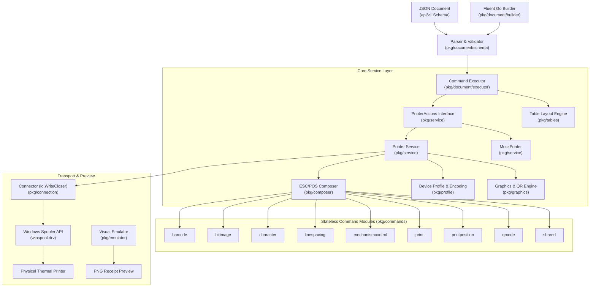

# Poster: Thermal Printer Driver & ESC/POS Utility


[](https://github.com/adcondev/poster/actions/workflows/ci.yml)

[](https://github.com/adcondev/poster/security/code-scanning)
[](https://github.com/adcondev/poster/actions/workflows/release.yml)

[](https://codecov.io/github/adcondev/poster)
[](https://goreportcard.com/report/github.com/adcondev/poster)
[](https://pkg.go.dev/github.com/adcondev/poster)

[](https://github.com/adcondev/poster/network/updates)
[](https://conventionalcommits.org)

<p align="center">
  
</p>

A professional, production-ready Go library and command-line utility for controlling ESC/POS thermal printers. Designed for high-reliability retail and POS environments, it features a robust JSON-based document protocol, native Windows Spooler integration, an advanced graphics engine, and a **visual emulator** for testing without physical hardware.

## 🚀 Key Features

- **JSON Document Protocol**: Define print jobs using a clean, versioned JSON schema (`v1.0`). Decouples business logic from hardware commands with full schema validation.
- **Native Windows Integration**: Prints directly via the Windows Print Spooler API (`winspool.drv`), supporting USB, Serial, and Network printers installed in Windows.
- **Advanced Graphics Engine**:
    - High-quality monochrome rasterization with **Atkinson** and **Threshold** dithering.
    - Configurable image scaling (`bilinear` and `nns` / `nearest_neighbor`).
    - Supports PNG, JPEG, and BMP formats (file paths or Base64).
- **Smart QR & Native Barcodes**:
    - **QR Codes**: Automatically selects between native printer firmware commands (`GS ( k`) and software bitmap rendering (`pkg/graphics`) when custom **logo overlays**, **circular modules** (`circle_shape`), or non-QR profiles are used.
    - **1D Barcodes**: Fast native ESC/POS (`GS k`) generation supporting `CODE128` (auto Set A/B/C), `EAN13`, `EAN8`, `UPCA`, `UPCE`, `CODE39`, `ITF`, and `CODABAR`.
- **Dynamic Table Layout**: Built-in engine for generating aligned receipts with UTF-8 word wrapping, multi-column support, configurable column spacing (`0+`), **automatic overflow detection**, and **smart widest-column-first auto-reduction** (`ReduceToFit`).
- **Visual Emulator**: Standalone 2D receipt preview engine (`pkg/emulator`) with embedded TrueType fonts (`JetBrainsMono`, `Ticketing`) and 5x7 ASCII fallback that renders print jobs to PNG images without physical hardware.
- **Hardware Profiles & Encodings**: Built-in profiles for standard 80mm (`576` dots), 58mm (`384` dots), PT-210, GP-58N, and EC-PM-80250 printers with 23 single-byte and Shift-JIS character code tables.
- **Smart Printer Discovery**: Enumerates and filters physical vs. virtual thermal/POS printers installed in the Windows Print Spooler.
- **11 Document Command Types**: `text`, `image`, `barcode`, `qr`, `table`, `separator`, `feed`, `cut`, `raw`, `pulse`, `beep`.
- **Raw Command Support**: Send raw hex ESC/POS byte sequences with safety checks against bidirectional lockups.

## 🏗️ Architecture

Poster follows a strict layered architecture separating JSON schema contracts, high-level orchestration, pure ESC/POS command generation, and OS transport:



### Package Structure

| Package | Description |
|---|---|
| `api/v1` | Canonical JSON Schema (`ticket_document.schema.json`) and protocol specification (`TICKET_DOCUMENT_V1.md`) |
| `cmd/poster` | CLI utility for printer discovery, JSON validation (`--dry-run`), and Windows Spooler printing |
| `internal/calculate` | Millimeter, DPI, and dot-per-line math utilities |
| `internal/load` | Path-traversal-safe file loader and PNG/JPEG/BMP image decoding (file & Base64) |
| `internal/testutils` | Shared unit test assertions, byte slice validators, and mock helpers |
| `pkg/commands` | Pure, stateless ESC/POS command builders (`barcode`, `bitimage`, `character`, `linespacing`, `mechanismcontrol`, `print`, `printposition`, `qrcode`, `shared`) |
| `pkg/composer` | High-level ESC/POS protocol facade (`EscposProtocol`) |
| `pkg/connection` | Transport interfaces (`Connector`, `PrinterService`) and Windows Spooler (`winspool.drv`) implementation |
| `pkg/constants` | Shared typed enums, standard paper/dot geometry (`576` / `384` dots), and schema-aligned defaults |
| `pkg/document` | JSON document AST & validator (`schema`), fluent Go DSL (`builder`), and command runner (`executor`) |
| `pkg/emulator` | Standalone 2D visual receipt emulator rendering PNG images with embedded TTF fonts |
| `pkg/graphics` | Image scaling, Atkinson/Threshold dithering, 1-bit bitmaps, and QR image rendering |
| `pkg/profile` | Hardware capability profiles (`80mm`, `58mm`, `PT-210`, `GP-58N`, `EC-PM-80250`) and character code tables |
| `pkg/service` | Stateful printer service (`Printer`), `PrinterActions` interface, and `MockPrinter` |
| `pkg/tables` | Multi-column table engine with UTF-8 word wrapping, header styling, and `ReduceToFit` auto-balancing |

## 📦 Installation

### Prerequisites

- **Go** `1.24.6` or higher
- **Windows OS** for native `winspool.drv` hardware printing (all library packages, tests, and the visual emulator run cross-platform on Linux, macOS, and Windows)

### As a Go Module

```bash
go get github.com/adcondev/poster@latest
```

### Build from Source

```bash
# Clone the repository
git clone https://github.com/adcondev/poster.git
cd poster

# Build the CLI binary
go build -o ./bin/poster ./cmd/poster

# Or run tests, linter, and build via Taskfile
task build
```

## 📖 Usage

### Command Line Interface (CLI)

The `poster` CLI validates and prints JSON ticket documents via the Windows Print Spooler:

```bash
# Print a JSON document to a specific Windows printer
poster -file receipt.json -printer "EPSON TM-T88V"

# Auto-detect the default/first thermal printer and print
poster -file receipt.json

# Dry-run (validate JSON schema and commands without touching hardware)
poster -file receipt.json --dry-run

# List installed printers (Windows only)
poster --list
poster --list-thermal
poster --list-physical
poster --list --json

# Show version
poster -v
```

### JSON Document Example (`api/v1`)

Create a file named `ticket.json` conforming to [`api/v1/ticket_document.schema.json`](api/v1/ticket_document.schema.json):

```json
{
  "version": "1.0",
  "profile": {
    "model": "Generic 80mm",
    "paper_width": 80,
    "dpi": 203,
    "has_qr": true
  },
  "commands": [
    {
      "type": "text",
      "data": {
        "content": {
          "text": "STORE NAME",
          "align": "center",
          "content_style": {
            "bold": true,
            "size": "2x2"
          }
        }
      }
    },
    {
      "type": "separator",
      "data": {
        "char": "-",
        "length": 48
      }
    },
    {
      "type": "table",
      "data": {
        "definition": {
          "columns": [
            { "name": "Item", "width": 20, "align": "left" },
            { "name": "Price", "width": 10, "align": "right" }
          ]
        },
        "show_headers": true,
        "rows": [
          ["Coffee", "$3.50"],
          ["Sandwich", "$8.00"]
        ],
        "options": {
          "header_bold": true,
          "word_wrap": true,
          "column_spacing": 1,
          "auto_reduce": true
        }
      }
    },
    {
      "type": "qr",
      "data": {
        "data": "https://example.com",
        "align": "center",
        "pixel_width": 256,
        "correction": "Q"
      }
    },
    {
      "type": "cut",
      "data": {
        "mode": "partial",
        "feed": 3
      }
    }
  ]
}
```

### Library Usage (Go)

#### 1. Fluent Document Builder + Executor

```go
package main

import (
	"log"

	"github.com/adcondev/poster/pkg/composer"
	"github.com/adcondev/poster/pkg/connection"
	"github.com/adcondev/poster/pkg/document/builder"
	"github.com/adcondev/poster/pkg/document/executor"
	"github.com/adcondev/poster/pkg/profile"
	"github.com/adcondev/poster/pkg/service"
)

func main() {
	doc, err := builder.NewDocument().
		SetProfile("Generic 80mm", 80).
		AddText(func(tb *builder.TextBuilder) {
			tb.Text("STORE NAME").Center().Bold().Size("2x2")
		}).
		Separator().
		AddQR(func(qb *builder.QRBuilder) {
			qb.Data("https://example.com").Center().PixelWidth(256)
		}).
		PartialCut().
		Build()
	if err != nil {
		log.Fatal(err)
	}

	conn, err := connection.NewWindowsPrintConnector("POS-80")
	if err != nil {
		log.Fatal(err)
	}
	defer func() { _ = conn.Close() }()

	prof := profile.CreateProfile80mm()
	printer, err := service.NewPrinter(composer.NewEscpos(), &prof, conn)
	if err != nil {
		log.Fatal(err)
	}
	defer func() { _ = printer.Close() }()

	exec := executor.NewExecutor(printer)
	if err := exec.Execute(doc); err != nil {
		log.Fatal(err)
	}
}
```

#### 2. Direct `service.Printer` Imperative API

```go
package main

import (
	"log"

	"github.com/adcondev/poster/pkg/composer"
	"github.com/adcondev/poster/pkg/connection"
	"github.com/adcondev/poster/pkg/profile"
	"github.com/adcondev/poster/pkg/service"
)

func main() {
	prof := profile.CreateProfile80mm()

	conn, err := connection.NewWindowsPrintConnector("POS-80")
	if err != nil {
		log.Fatal(err)
	}
	defer func() { _ = conn.Close() }()

	proto := composer.NewEscpos()
	printer, err := service.NewPrinter(proto, &prof, conn)
	if err != nil {
		log.Fatal(err)
	}
	defer func() { _ = printer.Close() }()

	_ = printer.Initialize()
	_ = printer.PrintLine("Hello World!")
	_ = printer.FullFeedAndCut(2)
}
```

## 📋 Supported Document Commands

| Command | Description |
|---|---|
| `text` | Formatted text with optional key-value `label`, alignment, bold, underline (`1dot`/`2dot`), inverse, font (`A`/`B`), and scaling (`1x1`..`8x8`) |
| `image` | Base64 PNG/JPEG/BMP raster printing with `atkinson` or `threshold` dithering and `bilinear` or `nns` scaling |
| `barcode` | Native ESC/POS 1D barcodes (`CODE128`, `EAN13`, `EAN8`, `UPCA`, `UPCE`, `CODE39`, `ITF`, `CODABAR`) with HRI text options |
| `qr` | Native or software-rendered QR codes with optional center `logo` and `circle_shape` modules |
| `table` | Multi-column tables with column alignment, UTF-8 word wrapping, bold headers, and `auto_reduce` |
| `separator` | Horizontal character repeat separator lines |
| `feed` | Paper advance (`1`–`255` lines) |
| `cut` | `full` or `partial` paper cut with configurable pre-cut `feed` (`0`–`255`) |
| `raw` | Hex-encoded raw ESC/POS command bytes with bidirectional safety validation |
| `pulse` | Cash drawer kick pulse (`ESC p`) on pin `0` or `1` |
| `beep` | Printer buzzer alert (`ESC B`) with configurable times and duration |

For complete protocol documentation and JSON schema definitions, see [`api/v1/TICKET_DOCUMENT_V1.md`](api/v1/TICKET_DOCUMENT_V1.md) and [`api/v1/ticket_document.schema.json`](api/v1/ticket_document.schema.json).

## ⚙️ Configuration

### Connection & Output Targets

| Target | Status | Description |
|---|---|---|
| `WindowsPrintConnector` | ✅ Implemented | Native Windows Print Spooler (`winspool.drv`) supporting USB, Serial, and Network printers installed in Windows |
| `MockPrinter` / `io.WriteCloser` | ✅ Implemented | In-memory mock and custom `io.WriteCloser` streams for unit testing and byte inspection |

### Built-in Printer Profiles (`pkg/profile`)

| Profile | Paper Width | Printable Width (203 DPI) | Description |
|---|---|---|---|
| `CreateProfile80mm()` | 80mm | 576 dots (48 chars Font A) | Standard 80mm ESC/POS (Epson TM-T88 series, etc.) |
| `CreateProfile58mm()` | 58mm | 384 dots (32 chars Font A) | Generic 58mm thermal printers |
| `CreatePt210()` | 58mm | 384 dots (32 chars Font A) | GOOJPRT PT-210 portable printer with QR support |
| `CreateGP58N()` | 58mm | 384 dots (32 chars Font A) | Gainscha GP-58N 58mm thermal printer |
| `CreateECPM80250()` | 80mm | 576 dots (48 chars Font A) | EC Line EC-PM-80250 80mm thermal printer |

## 🎨 Visual Emulator

The `pkg/emulator` package provides a standalone 2D visual receipt renderer that outputs PNG previews without physical hardware:

```go
package main

import (
	"os"

	"github.com/adcondev/poster/pkg/emulator"
)

func main() {
	emu, _ := emulator.NewEngine(emulator.DefaultConfig())

	emu.SetBold(true)
	emu.SetSize(2, 2)
	emu.AlignCenter()
	emu.PrintLine("STORE NAME")
	emu.Separator("-", 48)
	emu.Cut(true)

	f, _ := os.Create("preview.png")
	defer f.Close()
	_ = emu.WritePNG(f)
}
```

## 🛠️ Development & Testing

```bash
# Run all tests with race detection and coverage
go test -race -coverprofile=coverage.txt -covermode=atomic ./...

# Run static analysis and linters (golangci-lint v2)
golangci-lint run --timeout=5m

# Tidy module dependencies
go mod tidy
```

## 📊 Code Coverage

<details>
<summary>📈 Coverage Trends</summary>

[](https://codecov.io/gh/adcondev/poster)
</details>

## 🤝 Contributing

Contributions are welcome! Please read [CONTRIBUTING.md](CONTRIBUTING.md) and [AGENTS.md](AGENTS.md) for architectural invariants and guidelines.
This project uses [Conventional Commits](https://conventionalcommits.org) (`.commitlintrc.json`) and enforces semantic PR titles.

## 📄 License

This project is licensed under the MIT License — see the [LICENSE](LICENSE) file for details.
